# toskaUI

一套会动的 UI 组件。第一种材质叫“烟云”：组件和烟是同一种实心云，同色、硬边、会流，消失时缩没。组件结构照 [Reka UI](https://reka-ui.com)，动法的灵感来自 [goopUI](https://goop.timmcmasters.work)。

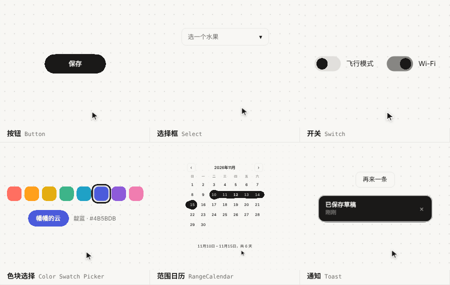

**[在线看全部组件](https://tangfanovo.github.io/toskaUI/)** · 61 个组件，算上各种样式一共 77 个 · 白天、灰底白云、夜里三套配色

## 全部组件

### 动作

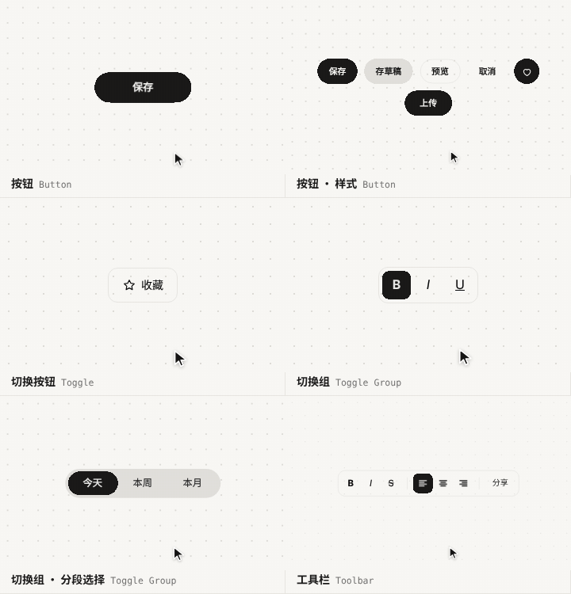

### 表单

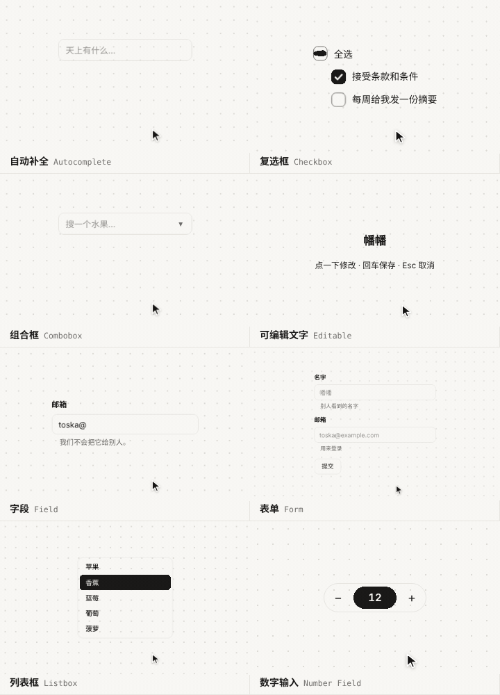
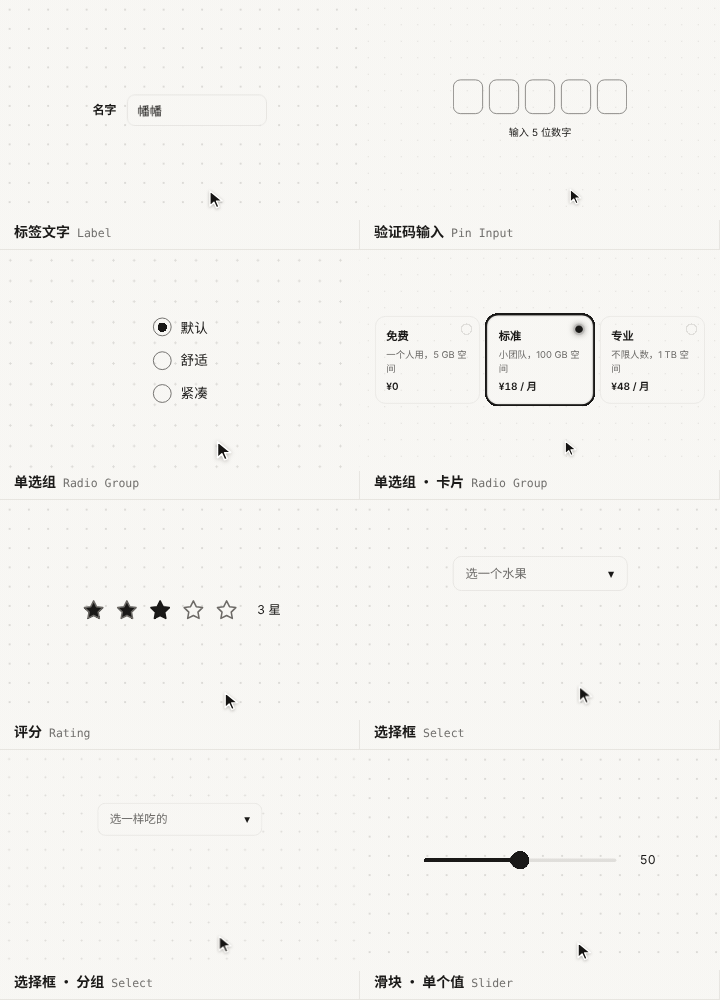
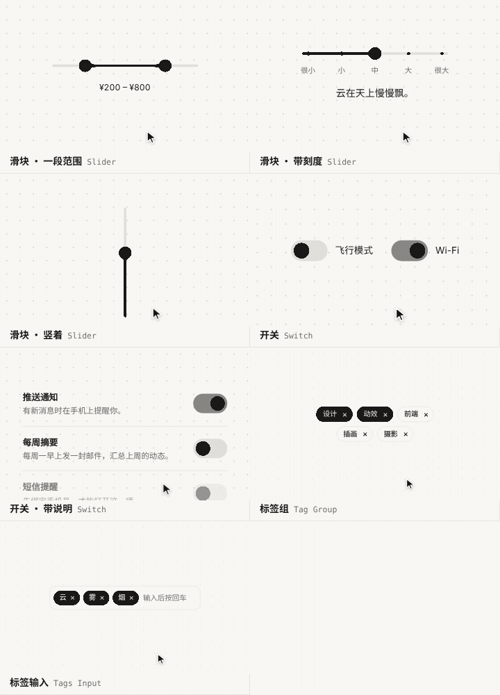

### 颜色

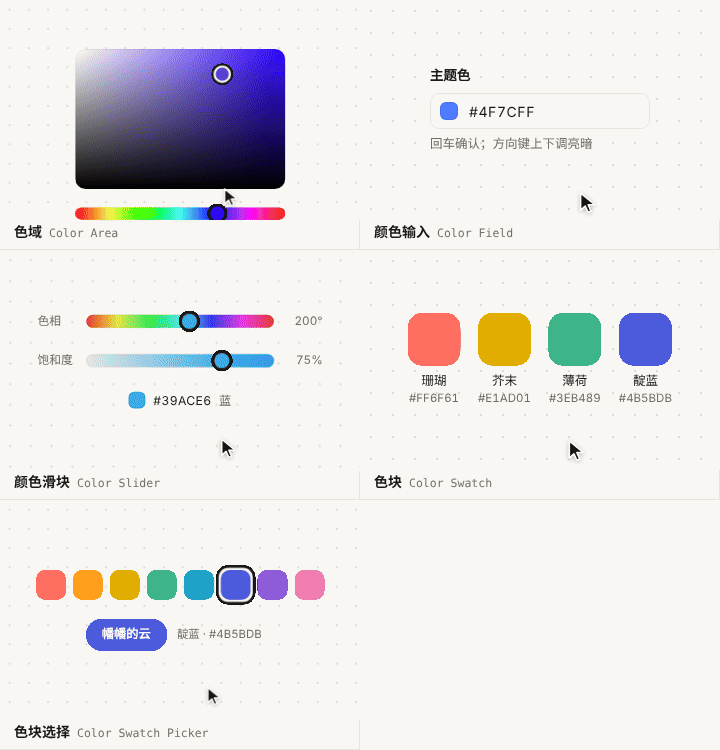

### 日期

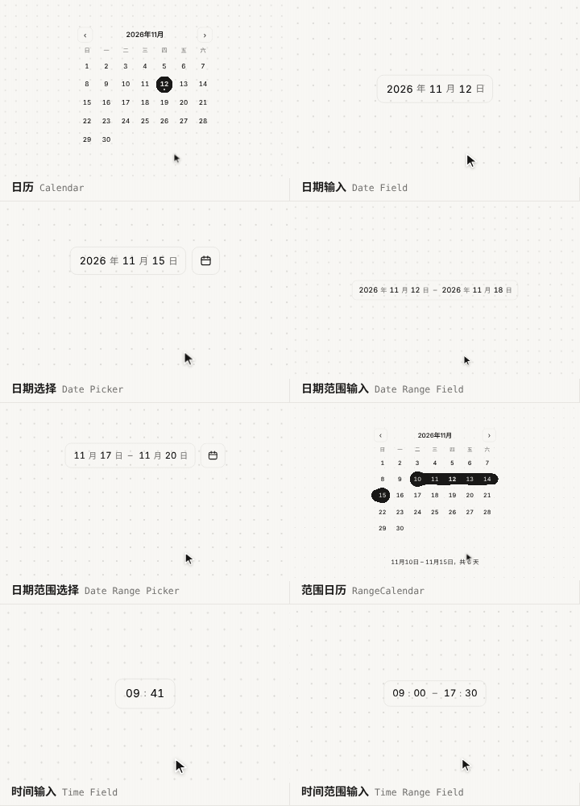
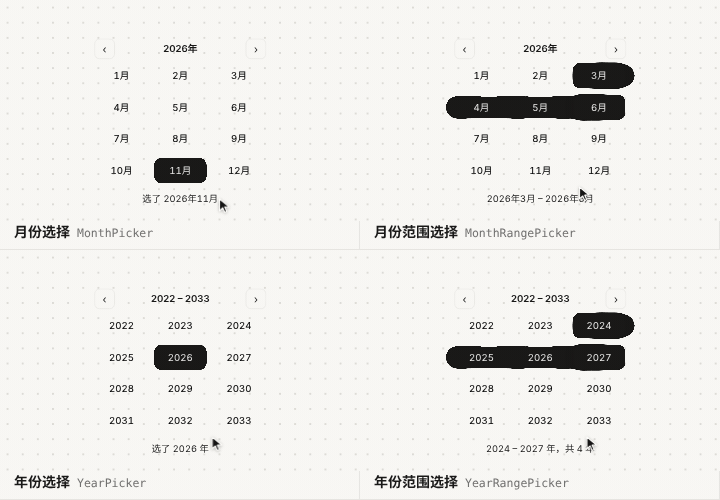

### 通用

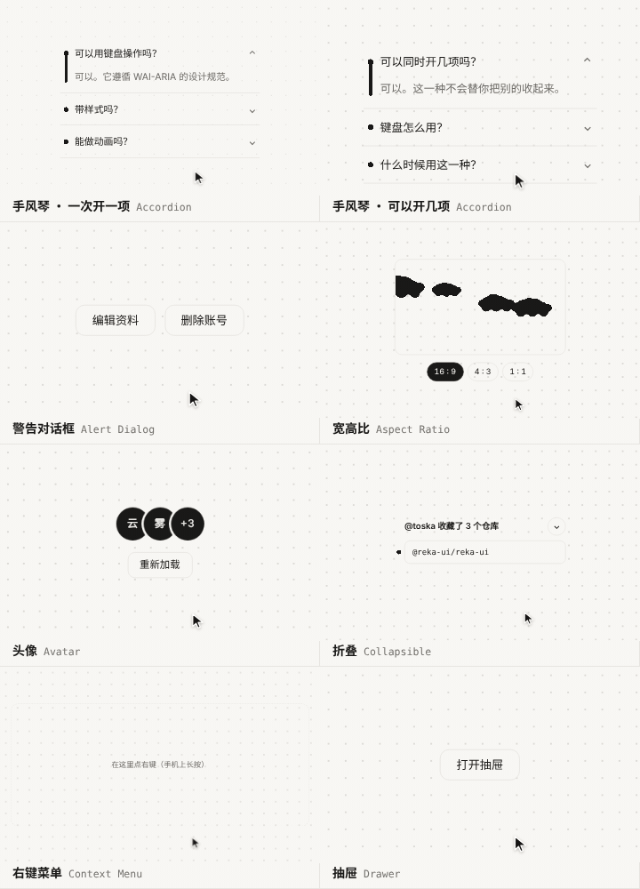
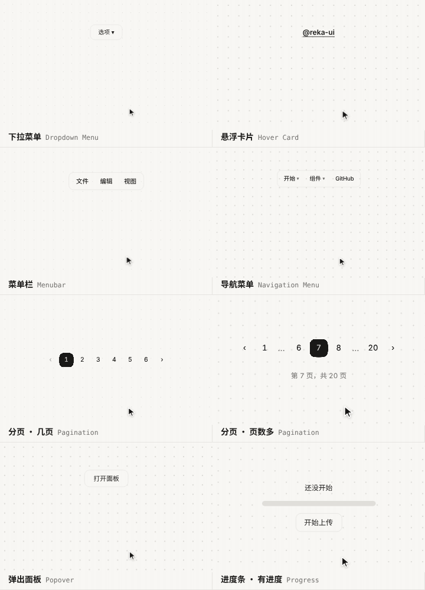
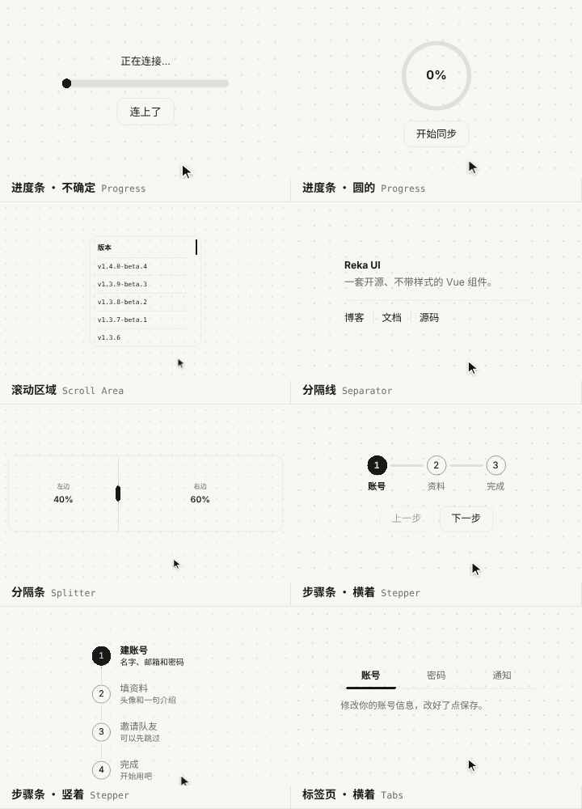
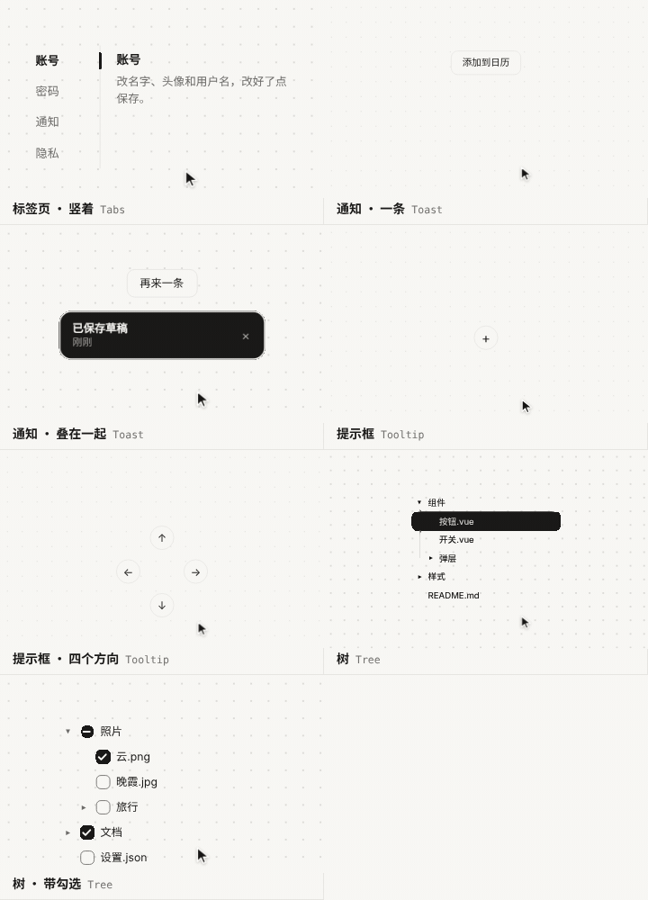

## 怎么用

- **复制代码**：在网站上点开一个组件，“复制代码”拿到的是一个完整的 HTML 文件，存下来用浏览器打开就能跑。颜色在 `:root` 的几个变量里，手感在脚本里的 `F`（速度、弹性、扭曲、烟雾）。
- **复制 Prompt**：一段说明，写清楚材质的规则和这个组件怎么动，交给 AI 用你自己的框架重做。
- 系统开了“减弱动态效果”时，烟、扭曲和回弹都会关掉，组件照常能用。

## 材质

| 材质 | 状态 | 源码 |
| --- | --- | --- |
| 烟云 | 61 个组件全部做完 | [`materials/cloud`](materials/cloud) |

以后的新材质放在 `materials/` 下面，跟烟云共用组件结构、文档站和演示脚本。

## 参考和致谢

- 组件结构、键盘操作和示例文字参考 [Reka UI](https://reka-ui.com)
- 材质和动法的灵感来自 [goopUI](https://goop.timmcmasters.work)（Tim McMasters）

## 作者

幡幡（Toska）· [@TangfanOVO](https://github.com/TangfanOVO)

## 许可

[MIT License](LICENSE)
